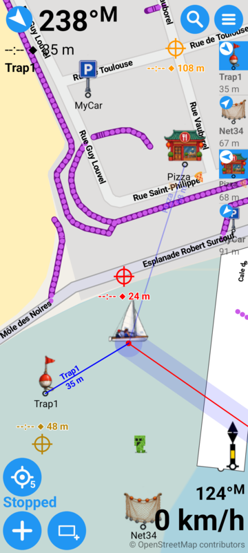
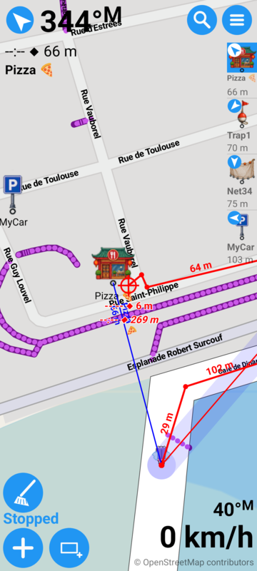
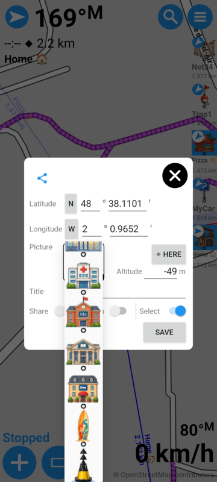
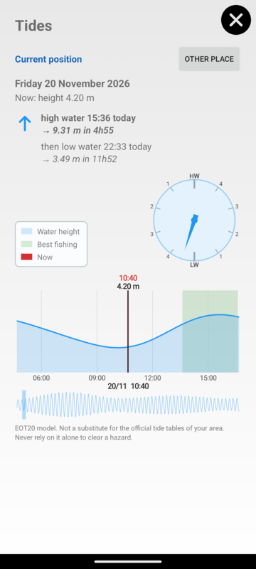
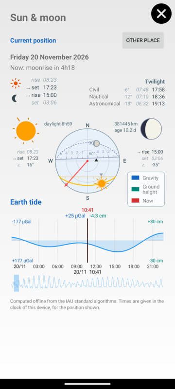
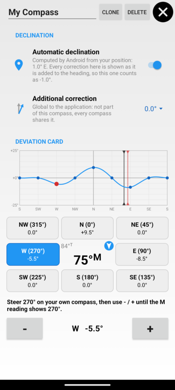
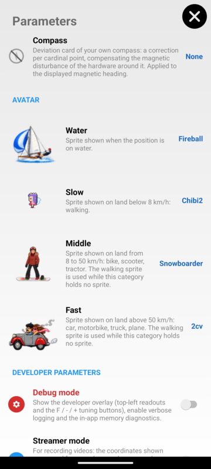
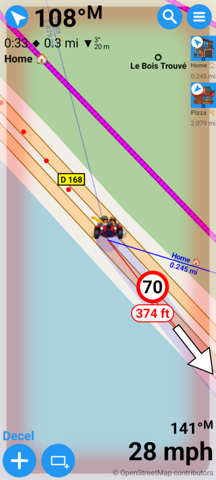
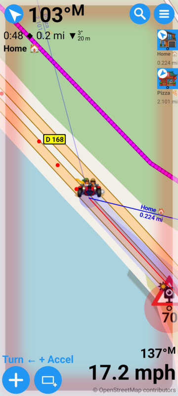

# MyBuoy

**MyBuoy by Golden-Block** is an outdoor navigation and mark-tracking app with
offline maps, for both boating and on-foot activities: sailing, fishing,
mushroom and flower foraging, and discovery walks.

- **Package:** `com.gb.mybuoy`
- **Android:** minSdk 21 · compile/target 35

## Screenshots

| Marks, sea marks and distances | Measuring | Editing a mark |
|:-:|:-:|:-:|
|  |  |  |
| **Tides** | **Sun and Moon** | **Compass deviation card** |
|  |  |  |
| **Avatars** | **Danger zone ahead** | **Slowing down in the zone** |
|  |  |  |

## Video tutorials

 **[@MyBuoyGB](https://www.youtube.com/@MyBuoyGB)**

The YouTube channel shows the app in use, feature by feature.

## Building

Requirements:

- **JDK 17**
- **Android SDK** with platform 35
- Gradle comes with the wrapper (Gradle 8.7, Android Gradle Plugin 8.6), nothing to install.

Steps:

1. Clone the repository.
2. Create `local.properties` at the root with the path to your Android SDK, for example
   `sdk.dir=/home/you/Android/Sdk` (Android Studio writes it for you).
3. Build the debug APK:

   ```
   ./gradlew assembleDebug
   ```

   The APK is in `app/build/outputs/apk/debug/`.

No account, key or service file is needed to build.

### Why a bundled SQLite

The offline land map uses a spatial index (SQLite **RTREE** module). The SQLite
that ships with Android is compiled without RTREE, so MyBuoy bundles the
official SQLite Android build as a local library:
`libs/sqlite-android-3530400.aar` (SQLite 3.53.04, public domain). The app
code uses its `org.sqlite.database` classes instead of Android's
`android.database.sqlite`. Do not replace it with the system SQLite or with
the `io.requery` fork: the first has no RTREE, the second is under another
licence. See [THIRD-PARTY-NOTICES.md](THIRD-PARTY-NOTICES.md).

## Roadmap

What is planned, what is in progress and what is already done is tracked in
[ROADMAP.md](ROADMAP.md) (French version: [ROADMAP_FR.md](ROADMAP_FR.md)).
The application links to it directly from its *Support the development*
screen.

Please have a look at the roadmap before opening an issue: not every item listed
there has been turned into a GitHub issue yet, so what you want to report may
already be planned.

## Support

See [SUPPORT.md](SUPPORT.md) for the ways to help the project.

## License

MyBuoy is free software licensed under the **GNU Affero General Public
License v3.0** (AGPL-3.0). See [LICENSE](LICENSE).

In short: you are free to use, study, modify and share it, but any modified
version you distribute **or run on a server** must also be released under the
AGPL-3.0.

### Commercial license

If the AGPL-3.0 obligations do not fit your use case (e.g. you want to build
a proprietary product on top of MyBuoy), a **commercial license** is available.
Contact **licence@golden-block.fr**.

## Contributing

Contributions are welcome. Please read [CONTRIBUTING.md](CONTRIBUTING.md):
contributors must accept the Contributor License Agreement (handled
automatically on your first Pull Request).

## Map data

MyBuoy uses land-polygon data derived from **OpenStreetMap**, © OpenStreetMap
contributors, available under the **Open Database License (ODbL)**.

## Third-party components

MyBuoy bundles portions of **Apache Commons IO** (© The Apache Software
Foundation), licensed under the **Apache License 2.0**. Those files keep their
original license headers under `app/src/main/java/org/apache/commons/io/`.
